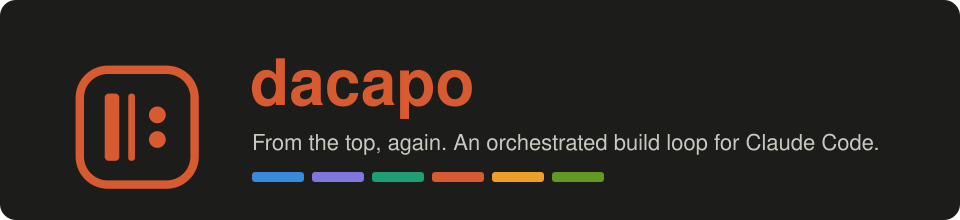
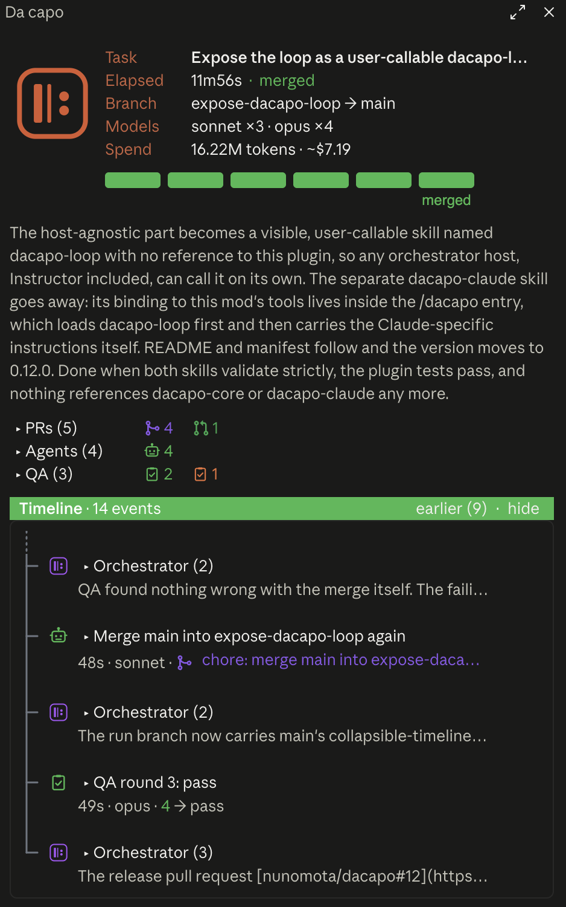

<p align="center">
  
</p>

<p align="center">
  A Claude Code mod that turns a handed-over task into a build loop: clarify, research, plan, build in parallel, QA as the end user, repeat until it passes, merge.
</p>

---

**dacapo** is an orchestration plugin for [Claude Code](https://claude.com/claude-code). You hand it a task. The session clarifies it with you, researches the stack and splits the work. Worker subagents build the pieces in parallel, each in its own git worktree, and land them through GitHub pull requests into a run branch. A QA subagent then uses the result the way a user would, scores a rubric, and the loop runs again until it passes. A final pull request merges the run branch into `main`.

Everything in the mod is deterministic: it manages worktrees, branches and pull requests, validates reports, wakes the orchestrator, and draws the pane. No model is asked anything inside it.

<p align="center">
  
</p>

## Install

You need [`gh`](https://cli.github.com), the GitHub CLI, installed and logged in (`gh auth login`), and a repository whose `origin` is on GitHub.

In a Claude Code session:

```
/plugin install dacapo --marketplace nunomota/dacapo
```

Answer `y` to add the marketplace and pick the user scope. The mod is active in that session and every later one.

## Use

```
/dacapo <what you want built>
```

The orchestrator then walks six phases, and the pane shows which one it is in:

1. **Clarify.** It restates the task and asks about anything material until nothing is open.
2. **Research.** It picks a stack if none is fixed, reads the docs for the versions in use, notes the build and test commands.
3. **Plan.** It names the run, cuts a run branch from `main`, splits the work into independent tasks, and writes the QA rubric and harness before any code exists.
4. **Implement.** One worker per task, in parallel. Each opens a draft pull request against the run branch, marks it ready when its build passes, waits for checks, and squash-merges with the planned title. A worker is finished only when its pull request is merged.
5. **QA.** A fresh subagent uses the deliverable as the end user and scores every rubric item `strong`, `acceptable` or `unacceptable`. On a fix verdict the loop goes back to step 4.
6. **Merge.** The orchestrator opens the final pull request into `main`, written to the `clean-prs` rules, and the mod merges it once its checks are green.

You can type while workers run. Your prompts become events in the timeline and are folded into the next round.

## What the mod enforces

- **Only workers change code.** While a run is active, the orchestrator cannot edit files, rewrite git history or touch pull requests by hand. Workers write inside their own worktree only.
- **Everything lands through pull requests.** Workers merge their own after green checks; the final merge into `main` is a pull request too. The mod never merges a branch locally.
- **Clean history.** Commits follow the bundled `clean-commits` skill: Conventional Commit titles, one unit of work each, no bodies, no attribution lines. Pull requests follow `clean-prs`: the planned title, one paragraph on the contribution, a `Verified:` line.
- **QA never reads source.** The QA subagent can only read the brief and rubric it was given and only write its report. The mod validates the report and derives the verdict.
- **Nothing is fired and forgotten.** Report collection, pull request polling, the final merge and every wake-up run on the mod's own timer. A wake-up that does not arrive is sent again.
- **Stale is not failed.** An agent silent for 30 minutes is marked stale and the orchestrator is told; after two idle hours it is stopped. Both are distinct from a failure.

## The pane

The header reads like fastfetch: the task, elapsed time, branch, models and spend, then a phase bar whose done phases are grey, current phase colored and named, phases ahead hollow. Three rows count pull requests by state, agents by outcome and QA rounds by verdict, each expanding to its items. Below them the timeline is a tree of everything that happened: your messages, the orchestrator's answers, every worker with a link to its pull request, every QA round with its scores. It shows the latest five events and folds the rest behind `earlier`.

One color code throughout: teal in progress, green done, yellow done with limitations or recommendations, orange failed.

## Tools

The orchestrator calls these; the `dacapo` skill says when.

| Tool | What it does |
| --- | --- |
| `start` | Checks `gh`, pulls the base branch, cuts the run branch in its worktree and pushes it. |
| `dispatch` | Prepares one worktree, branch and brief per task; `resume: true` continues an earlier worker. |
| `sync` | Confirms which pull requests merged, prunes their branches, fast-forwards the run worktree. |
| `qa` | Prepares the QA worktree with the rubric and harness. |
| `finish` | Opens the final pull request; the mod merges it when green. |
| `status`, `phase`, `cancel` | The timeline as text, the phase marker, stopping an agent. |

## Skills

| Skill | Purpose |
| --- | --- |
| `/dacapo` | The entry point: loads the loop and binds it to this mod's tools and subagents. |
| `/dacapo-loop` | The loop's specification: roles, boundaries, host guarantees, report contracts and decision rules, for other orchestrators to follow with their own way to run agents and land work. |
| `/clean-commits` | The commit rules workers follow. |
| `/clean-prs` | The pull request rules workers and the final pull request follow. |

## Development

```
claude plugin validate .
claude plugin test .
```

Mods are built on function hooks (`hooks/register.tsx`), an early-access Claude Code API; it may change between releases. Pull request state comes from one `gh pr list` call every 20 seconds on the mod's timer. Cost estimates use Anthropic list prices per model; override them with the plugin's `prices` option.

## Known limits

- The QA agent keeps a shell so it can run the deliverable, so reading source through a shell command is forbidden by its prompt rather than by the tooling.
- Branch protection that requires reviews stops a worker's merge and the final merge; the orchestrator is told, and merging on GitHub by hand finishes the run.
- The timeline lives for the session; it is not kept across restarts.

Inspired by [savvy-progress](https://github.com/JohnnyVizz/claude-kit).

## License

MIT
